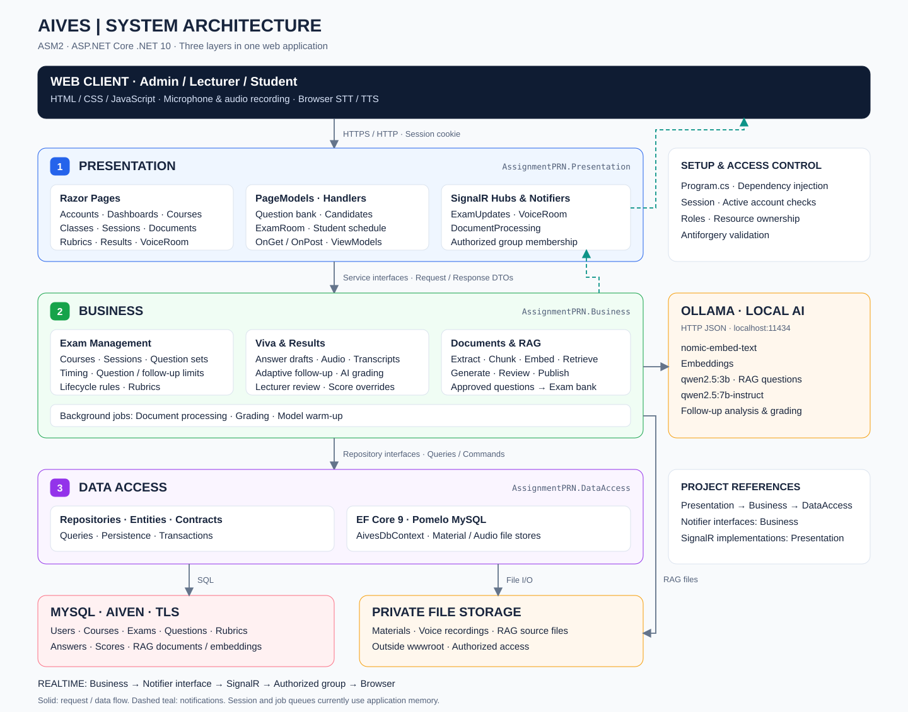

# assignment_prn

ASP.NET Core MVC (.NET 10), MySQL, kiến trúc ba tầng Presentation → Business → DataAccess.



## Bắt đầu

Dự án cần một database MySQL có sẵn dữ liệu. **Dump đầy đủ nằm ở
[`database/dump/`](database/dump/)** — import file đó là có ngay schema và dữ liệu, không
cần chạy thêm script nào:

```bash
mysql -u <user> -p -e "CREATE DATABASE aives CHARACTER SET utf8mb4 COLLATE utf8mb4_unicode_ci;"
mysql -u <user> -p aives < database/dump/aives_20261002.sql
```

Sau đó chép `src/AssignmentPRN.Presentation/appsettings.json.example` thành
`appsettings.json` và điền chuỗi kết nối của bạn, rồi:

```bash
dotnet run --project src/AssignmentPRN.Presentation
```

Thứ tự chạy đầy đủ, cách nâng cấp schema đã có, cách xuất dump mới và dữ liệu thử để demo:
[database/README.md](database/README.md).

## Tài liệu

| Chủ đề | Tài liệu |
|---|---|
| Kiến trúc, luồng request, cách kết nối MySQL | [docs/architecture.md](docs/architecture.md) |
| Môn học và phiên thi — hướng dẫn chạy, quy tắc nghiệp vụ, checklist | [docs/mon-hoc-va-phien-thi.md](docs/mon-hoc-va-phien-thi.md) |
| Môn học và phiên thi — kiến trúc ba tầng của chức năng | [docs/kien-truc-mon-hoc-va-phien-thi.md](docs/kien-truc-mon-hoc-va-phien-thi.md) |
| Môn học và phiên thi — luồng toàn hệ thống và kết quả kiểm thử | [docs/kiem-thu-mon-hoc-va-phien-thi.md](docs/kiem-thu-mon-hoc-va-phien-thi.md) |
| Bộ câu hỏi (ngân hàng câu hỏi, import CSV, phát đề) | [docs/bo-cau-hoi.md](docs/bo-cau-hoi.md) |
| Câu hỏi đào sâu và kết quả thi | [docs/cau-hoi-dao-sau-va-ket-qua.md](docs/cau-hoi-dao-sau-va-ket-qua.md) |
| Lưu tạm đáp án | [docs/exam-answer-drafts.md](docs/exam-answer-drafts.md) |
| Trạng thái phiên thi | [docs/exam-session-lifecycle.md](docs/exam-session-lifecycle.md) |
| Quy tắc phiên thi dùng chung | [docs/shared-exam-session-rules.md](docs/shared-exam-session-rules.md) |
| Cấu hình đề dùng chung | [docs/shared-question-configuration.md](docs/shared-question-configuration.md) |
| Đề tài gốc | [docs/topic.md](docs/topic.md) |

## Kiểm thử

```bash
dotnet test AssignmentPRN.slnx
```


## ASM2 integration notes
# assignment_prn

## Phân quyền

| Nghiệp vụ | Admin | Giảng viên | Sinh viên |
| --- | --- | --- | --- |
| Xem/quản lý lịch thi | Tất cả | Chỉ lịch mình phụ trách | Không |
| Xem/quản lý lớp | Tất cả | Chỉ lớp mình phụ trách | Không |
| Thêm, xoá, tìm sinh viên trong lớp | Có | Chỉ lớp mình phụ trách | Không |
| Tra cứu lịch sinh viên | Có | Có | Chỉ lịch của mình |
| Tự đăng ký tài khoản | Tạo tài khoản Sinh viên | Tạo tài khoản Sinh viên | Tạo tài khoản Sinh viên |

Đăng nhập, đăng ký, đăng xuất và trang từ chối truy cập nằm trong `Pages/Account`.
Các thao tác thay đổi lịch thi hoặc sĩ số lớp được phát qua SignalR tại
`/hubs/exam-updates` để các phiên đang mở nhận thông báo cập nhật.
