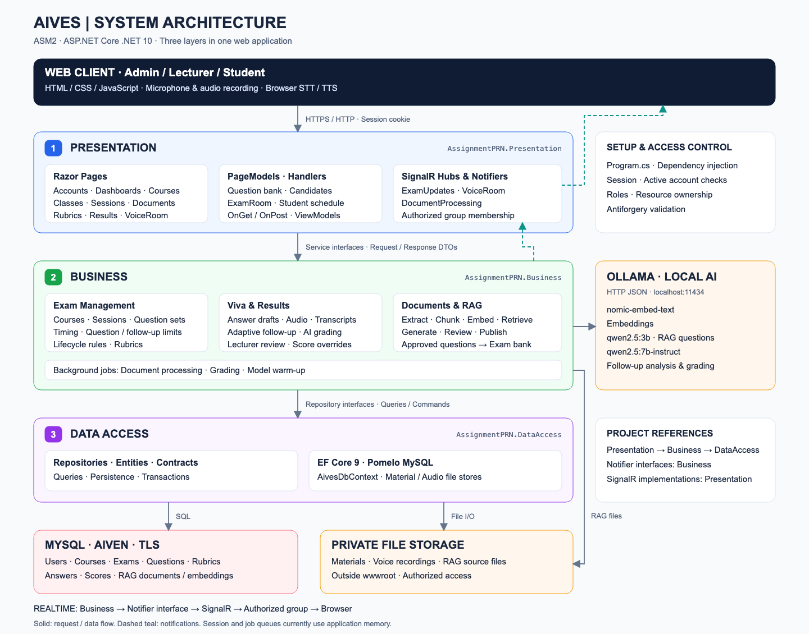

# Kiến trúc hệ thống AIVES — ASM2

Sơ đồ mô tả mã nguồn hiện tại: ứng dụng ASP.NET Core .NET 10 tổ chức thành ba project Presentation → Business → DataAccess. Toàn bộ giao diện dùng Razor Pages; dự án không còn MVC controller.

Tải [SVG](kien-truc-tong-quan.svg) hoặc [PNG](kien-truc-tong-quan.png) để trình chiếu. [Nguồn Mermaid](architecture.mmd) mô tả cùng các thành phần và quan hệ; bố cục Mermaid được trình xem tự sắp xếp. [architecture.svg](architecture.svg) là bản tương thích cho các liên kết tài liệu cũ.

## Trách nhiệm ba tầng

| Tầng / project | Thành phần chính | Trách nhiệm |
|---|---|---|
| Presentation / AssignmentPRN.Presentation | Pages, PageModels, ViewModels, Hubs, SignalR notifiers, JavaScript | Nhận request, binding / validation đầu vào, xác thực session, kiểm tra quyền truy cập, hiển thị kết quả và gửi cập nhật thời gian thực. |
| Business / AssignmentPRN.Business | Service interfaces, services, DTO, policies, AI adapters, background services | Điều phối nghiệp vụ; môn học, lớp, phiên thi, phát đề, thời gian mỗi câu, số câu chính, lượt hỏi xoáy, phòng thi, RAG, rubric, chấm và duyệt điểm. |
| DataAccess / AssignmentPRN.DataAccess | Repositories, Entities, Contracts, AivesDbContext, file stores | Truy vấn / ghi dữ liệu bằng EF Core và Pomelo MySQL; transaction, lưu tệp tài liệu môn học và audio. |

Các project tham chiếu theo hướng Presentation → Business → DataAccess. Program.cs là nơi ghép triển khai bằng dependency injection: AddBusiness() gọi AddDataAccess(). Hợp đồng thông báo nằm ở Business; triển khai SignalR nằm ở Presentation, nên Business không cần tham chiếu project giao diện. IExamStatePolicy được khai báo ở DataAccess và triển khai ở Business để repository áp dụng quyết định trạng thái trong transaction.

Ba tầng là cách tổ chức mã nguồn. Hiện chúng chạy trong cùng một ứng dụng web, chưa tách thành ba dịch vụ triển khai độc lập.

## Giao diện hiện tại

Mọi màn hình là một Razor Page (`.cshtml` có `@page`) đi cùng PageModel (`.cshtml.cs`). GET nạp dữ liệu qua `OnGet…`; mỗi thao tác POST là một handler `OnPost<Tên>…`, gọi bằng `asp-page-handler`.

| Thư mục Pages | Chức năng |
|---|---|
| Account, Index | Đăng nhập / đăng ký / đăng xuất; trang gốc chuyển về dashboard theo vai trò. |
| Admin, Lecturer, Student | Dashboard theo vai trò. |
| Courses, Classes, CourseMaterials | Môn học, lớp và danh sách sinh viên, tài liệu môn học. |
| Questions, Documents, Rubrics | Ngân hàng câu hỏi và nhập CSV, tài liệu RAG và duyệt câu hỏi AI, rubric. |
| ExamSessions, ExamStudents, StudentSchedule | Phiên thi, sinh viên trong phiên thi, lịch thi sinh viên. |
| ExamRoom, VoiceRoom, ExamResults, MyResults | Phòng thi trắc nghiệm, phòng thi giọng nói, kết quả giảng viên / sinh viên. |

Phần markup dùng lại giữa các trang nằm trong Pages/Shared; mỗi nhóm trang dùng chung một PageModel nền (ví dụ ClassesPage) chứa logic của nhóm đó.

## Luồng request và cập nhật thời gian thực

1. Trình duyệt gửi HTTP request kèm session cookie.
2. Middleware kiểm tra tài khoản còn hoạt động và vai trò còn khớp session; PageModel / service kiểm tra quyền theo tài nguyên.
3. PageModel gọi service interface, truyền request DTO.
4. Business kiểm tra quy tắc và gọi repository hoặc dịch vụ lưu tệp. Repository dùng AivesDbContext để thao tác MySQL qua TLS.
5. Sau thay đổi, Business gọi notifier interface; triển khai tại Presentation dùng IHubContext để gửi thông báo đến nhóm được phép.
6. JavaScript nhận sự kiện SignalR và cập nhật màn hình. Trang vẫn lấy dữ liệu qua các điểm vào có kiểm tra quyền.

| Hub | Endpoint | Mục đích |
|---|---|---|
| ExamUpdatesHub | /hubs/exam-updates | Cập nhật phiên thi, danh sách / tiến độ cho màn hình quản lý. |
| VoiceRoomHub | /hubs/voice-room | Đồng bộ sự kiện phòng thi và chấm điểm. |
| DocumentProcessingHub | /hubs/document-processing | Tiến độ xử lý tài liệu và sinh câu hỏi. |

Quyền tham gia nhóm được kiểm tra ở server. SignalR là kênh thông báo; quy tắc chuyển trạng thái, thời gian thi và quyền dữ liệu vẫn do server quyết định.

## Luồng AI và RAG

- Tài liệu PDF / DOCX / PPTX được lưu riêng, đưa vào DocumentProcessingQueue rồi xử lý nền: trích xuất văn bản, chia đoạn và tạo embedding.
- Embedding được lưu dạng JSON trong MySQL; ứng dụng tính độ tương đồng và lấy ngữ cảnh cho RAG. Hiện chưa có vector database riêng.
- Ollama sinh câu hỏi nháp; giảng viên duyệt. Khi duyệt, hệ thống xuất bản vào ngân hàng questions và liên kết bằng bank_question_id; câu được phát đề từ ngân hàng chính.
- Trong phòng thi, trình duyệt dùng microphone / MediaRecorder; SpeechRecognition chuyển giọng nói thành transcript và speechSynthesis đọc nội dung khi trình duyệt hỗ trợ.
- Business gửi transcript / ngữ cảnh đến Ollama để hỏi xoáy. Bài hoàn thành đi vào GradingQueue; tiến trình nền chấm theo rubric, lưu đánh giá và tổng hợp điểm. Giảng viên có thể duyệt / chỉnh điểm theo quyền.

| Model cấu hình hiện tại | Vai trò |
|---|---|
| nomic-embed-text | Embedding tài liệu / truy vấn RAG. |
| qwen2.5:3b | Sinh câu hỏi từ ngữ cảnh RAG. |
| qwen2.5:7b-instruct | Phân tích câu trả lời, hỏi xoáy và chấm điểm. |

Ollama được gọi qua HTTP JSON, mặc định cổng 11434. STT / TTS trong luồng hiện tại dùng API trình duyệt, không phải mô hình Ollama xử lý âm thanh trực tiếp.

## Dữ liệu và tệp

| Nơi lưu | Dữ liệu |
|---|---|
| MySQL / Aiven | Tài khoản / vai trò, môn / lớp, phiên / sinh viên, ngân hàng câu hỏi, rubric, đáp án / hỏi xoáy, đánh giá / kết quả, tài liệu / chunks / câu RAG, thông báo. |
| Storage/materials | Tài liệu môn học qua LocalMaterialFileStore. |
| Storage/voice-audio | Bản ghi câu trả lời qua LocalVoiceAudioStore. |
| Storage/rag | Tệp nguồn của luồng tài liệu RAG; DocumentService / tiến trình xử lý tài liệu quản lý trực tiếp. |

Kho tệp riêng nằm ngoài wwwroot; tải / đọc tệp đi qua điểm vào có kiểm tra quyền. Session và hai hàng đợi xử lý nền hiện dùng bộ nhớ của tiến trình ứng dụng. Khởi động lại không bảo toàn session hoặc nội dung hàng đợi như một message broker bền vững.

Kiểm tra database lúc khởi động chỉ xác nhận kết nối / dữ liệu. Nâng cấp schema dùng các script trong database/ và scripts/ theo [hướng dẫn database](../database/README.md), không phải tự động chạy toàn bộ migration khi mở web.

## Đọc code khi thuyết trình

- [Program.cs](../src/AssignmentPRN.Presentation/Program.cs): đăng ký Razor Pages, session, middleware và ba hub.
- [Business registration](../src/AssignmentPRN.Business/ServiceCollectionExtensions.cs): ghép services, policies, AI adapters và background services.
- [Pages](../src/AssignmentPRN.Presentation/Pages): giao diện Razor Pages / PageModels.
- [Business services](../src/AssignmentPRN.Business/Services): nghiệp vụ và xử lý AI / RAG.
- [Repositories](../src/AssignmentPRN.DataAccess/Repositories): truy vấn, cập nhật và transaction dữ liệu.
