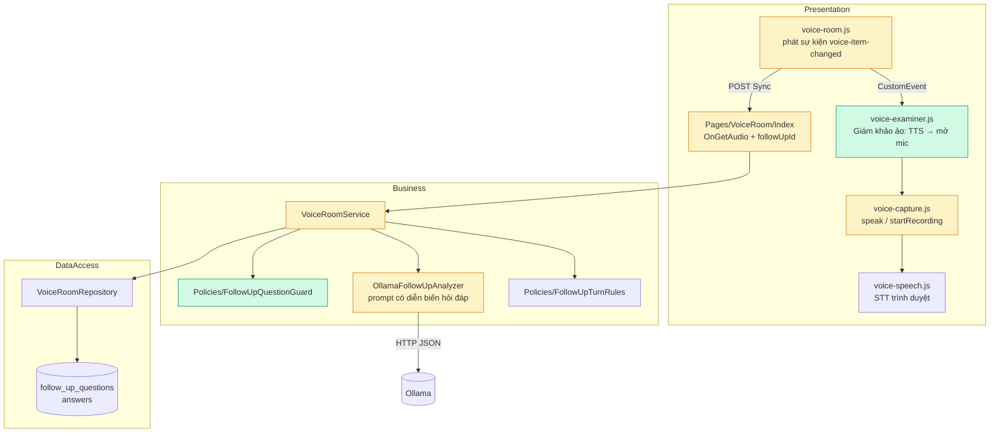
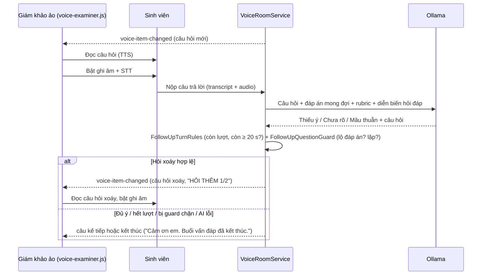

# Nhóm chức năng 3 — Lõi phỏng vấn AI

Tài liệu này mô tả nhóm chức năng 3 của đề tài AIVES: **AI đóng vai giám khảo ảo**, hỏi
bằng giọng nói, nghe sinh viên trả lời bằng giọng nói, và **hỏi xoáy thích ứng** khi câu
trả lời còn thiếu ý, mơ hồ hoặc mâu thuẫn — trong giới hạn thời gian và số lượt hỏi xoáy.

Phần lớn nền tảng đã có từ phần 5 (phòng thi giọng nói) và phần 6 (AI hỏi xoáy, xem
[phan-6-tong-ket.md](phan-6-tong-ket.md)). Bản này hoàn thiện những chỗ còn thiếu để luồng
"giám khảo ảo" chạy trọn vẹn, **giữ nguyên kiến trúc ba tầng** Presentation → Business →
DataAccess và **không đổi schema database**.

## 1. Đối chiếu yêu cầu

| Yêu cầu đề tài | Cách đáp ứng | Trạng thái |
|---|---|---|
| AI đọc câu hỏi bằng giọng nói (TTS) | `voice-examiner.js` tự đọc mỗi câu hỏi **và mỗi câu hỏi xoáy** ngay khi mở, bằng `speechSynthesis`, chọn giọng theo ngôn ngữ câu hỏi | **Mới** — trước đây sinh viên phải tự bấm "Nghe câu hỏi" |
| Sinh viên trả lời bằng giọng nói, STT gần thời gian thực | Đọc xong, giám khảo ảo tự bật ghi âm; `voice-speech.js` nhận dạng liên tục (`interimResults`), chữ hiện dần trong ô văn bản | Tự bật ghi âm: **mới**; STT: có sẵn |
| Hỏi xoáy thích ứng dựa trên nội dung trả lời | `VoiceRoomService` → `IFollowUpAnalyzer` (Ollama) quyết định Thiếu ý / Chưa rõ / Mâu thuẫn | Có sẵn |
| Phát hiện **mâu thuẫn** như giảng viên | AI nhận **toàn bộ diễn biến hỏi đáp** của câu (trả lời đầu + từng câu hỏi xoáy và câu trả lời), không chỉ câu nói cuối | **Mới** — trước đây lượt hỏi xoáy thứ 2 không thấy câu trả lời đầu nên không thể bắt mâu thuẫn |
| Câu hỏi xoáy không được lộ đáp án | `FollowUpQuestionGuard` chặn câu hỏi chứa một cụm ≥ 5 từ của đáp án mong đợi mà sinh viên chưa nghe/chưa nói | **Mới** — mục "giới hạn" của phần 6 |
| Không hỏi lặp | Cùng guard chặn câu hỏi xoáy trùng ≥ 80% từ với câu đã hỏi | **Mới** |
| Giới hạn thời gian trả lời | `ExamVivaSettings.SecondsPerQuestion`; câu hỏi xoáy dùng chung thời gian của câu gốc, còn < 20 giây thì không hỏi | Có sẵn |
| Số lượt hỏi xoáy tối đa mỗi câu | `MaxFollowUpsPerQuestion` (mỗi câu) và `MaxFollowUpCount` (cả lượt thi) | Có sẵn |
| Sinh viên biết trước giới hạn | Màn hình hiện "Giám khảo AI có thể hỏi thêm tối đa N câu…" và "HỎI THÊM 1/2" | **Mới** |
| Lưu vết đầy đủ cuộc phỏng vấn | Bản thu của **câu hỏi xoáy** nghe lại được (trước đây chỉ nghe được bản thu câu gốc) | **Mới** |

## 2. Thay đổi theo tầng



Xanh: file mới · Vàng: file sửa.

| Tầng | File | Thay đổi |
|---|---|---|
| Business — hợp đồng | `Interfaces/GradingContracts.cs` | `FollowUpContext` thêm `OriginalAnswer`, `Exchanges` (tham số tùy chọn, không phá code cũ) |
| | `Interfaces/VoiceRoomContracts.cs` | `VoiceQuestion` thêm `FollowUpNumber`, `FollowUpLimit`; `DownloadAsync` nhận `followUpId` |
| Business — luật | `Policies/FollowUpQuestionGuard.cs` (**mới**) | Hàm thuần: chặn câu hỏi xoáy lộ đáp án hoặc lặp lại; không chạm repository hay model |
| Business — AI | `Services/OllamaFollowUpAnalyzer.cs` | Prompt có mục "Diễn biến hỏi đáp", yêu cầu đối chiếu câu mới nhất với điều đã nói |
| Business — nghiệp vụ | `Services/VoiceRoomService.cs` | Dựng ngữ cảnh đầy đủ; áp guard sau khi AI quyết định; tính giới hạn hỏi xoáy; tải bản thu câu hỏi xoáy (kiểm tra câu hỏi xoáy thuộc đúng câu trả lời của chính sinh viên) |
| Presentation | `Pages/VoiceRoom/Index.cshtml(.cs)` | Công tắc "Giám khảo ảo", dòng giới hạn hỏi xoáy, handler `Audio` nhận `followUpId` |
| | `UI Assets/js/voice-examiner.js` (**mới**) | Điều phối đọc câu hỏi → chờ 0,45 s → bật ghi âm |
| | `UI Assets/js/voice-capture.js` | Tách `speak()` (trả về đã đọc hết hay chưa) và `startRecording()`; reset trạng thái theo từng *mục* (câu hỏi hoặc câu hỏi xoáy) |
| | `UI Assets/js/voice-room.js` | Phát `voice-item-changed`; hiện "HỎI THÊM n/N", link nghe bản thu câu hỏi xoáy |
| | `UI Assets/js/voice-mic-check.js` | Phát `voice-mic-ready` khi đóng hộp kiểm tra mic |
| DataAccess | — | Không đổi. Bảng `follow_up_questions` đã có đủ cột |

Nguyên tắc giữ nguyên:

- **Business không tham chiếu Presentation.** Giám khảo ảo là phần trình bày; máy chủ vẫn là
  nơi duy nhất quyết định thời gian, ngân sách hỏi xoáy và mục đang mở.
- **Không gọi model trong giao dịch giữ khoá.** Guard chạy sau khi model trả lời, trước giao
  dịch ghi câu hỏi xoáy.
- **AI hỏng thì phòng thi vẫn chạy.** Guard từ chối → phòng thi đi tiếp như khi AI nói "đủ ý".
- `voice-examiner.js` chỉ nghe một sự kiện DOM và gọi `window.voiceCapture`; tắt công tắc thì
  phòng thi trở về đúng hành vi cũ.

## 3. Luồng một câu hỏi



### Giám khảo ảo không tự mở mic khi

- Hộp kiểm tra microphone còn mở (chờ sự kiện `voice-mic-ready`, cũng là cú bấm cho phép
  trình duyệt phát giọng nói).
- Không đọc được câu hỏi (trình duyệt chặn TTS, không hỗ trợ, hoặc sinh viên bấm dừng).
- Tải lại trang khi câu đang trả lời dở (đã có văn bản hoặc bản thu).
- Câu hỏi còn dưới 3 giây.
- Sinh viên tắt công tắc (lưu trong `localStorage`, chỉ là tuỳ chọn hiển thị).

### Luật chặn lộ đáp án

Một câu hỏi xoáy bị bỏ khi nó chứa một cụm **5 từ liên tiếp** (Việt: ~2–3 từ ghép) có trong
đáp án mong đợi mà **không** có trong: câu hỏi gốc, lời sinh viên đã nói, hay các câu hỏi xoáy
trước. Đáp án ngắn (< 5 từ, ví dụ `lock`) được so nguyên cụm; đáp án một âm tiết ngắn ("Có",
"Không") bỏ qua vì quá phổ biến. Nhờ vậy giám khảo vẫn được hỏi "Em vừa nói X, …" khi chính sinh
viên đã nói X.

## 4. Cấu hình

Không thêm khoá cấu hình mới. Giảng viên chỉnh ở **Phiên thi → Cấu hình vấn đáp**:

| Thiết lập | Ý nghĩa |
|---|---|
| Số giây mỗi câu | Thời gian trả lời một câu, **bao gồm** các câu hỏi xoáy của câu đó |
| Số câu hỏi xoáy tối đa mỗi câu | Giới hạn hỏi xoáy trên một câu |
| `MaxFollowUpCount` của phiên | Giới hạn hỏi xoáy trên cả lượt thi |

Hằng số trong code: còn ≥ 20 giây mới hỏi xoáy (`FollowUpTurnRules.MinimumTimeToProbe`), cụm lộ
đáp án 5 từ (`FollowUpQuestionGuard.LeakRunLength`), ngưỡng trùng 80%
(`FollowUpQuestionGuard.RepeatSimilarity`).

## 5. Demo

1. Chuẩn bị như [phan-6-tong-ket.md mục 6](phan-6-tong-ket.md#6-cách-chạy-thử) (MySQL, Ollama
   `qwen2.5:7b-instruct`, seed `seed_test_flow.sql` + `seed_test_rubrics.sql`). Dùng Chrome hoặc
   Edge (cần Web Speech API).
2. Đăng nhập sinh viên → Lịch thi của tôi → **Thi giọng nói** → kiểm tra mic → **Vào phòng thi**.
3. Giám khảo ảo đọc câu 1, rồi trạng thái chuyển "Đang ghi âm câu trả lời của bạn". Nói câu
   trả lời ngắn, thiếu ý ("Em nghĩ là để khoá lại ạ") → **Nộp câu trả lời**.
4. "Giám khảo đang xem…" → câu hỏi xoáy hiện "HỎI THÊM 1/N", kèm lý do, và được đọc to.
5. Trả lời ngược với câu đầu → lượt hỏi xoáy kế tiếp (nếu cấu hình ≥ 2) có thể có lý do
   "chưa nhất quán".
6. Mở "Các câu đã nộp": mỗi câu hỏi xoáy có link **Nghe bản thu câu hỏi thêm**.
7. Tắt công tắc "Giám khảo ảo…" → phòng thi trở về chế độ bấm tay.

## 6. Kiểm thử

| Nhóm | File | Ca mới |
|---|---|---|
| Luật chặn lộ đáp án / lặp | `tests/AssignmentPRN.Tests/FollowUpQuestionGuardTests.cs` | 13 |
| Phòng thi với AI giả lập | `VoiceFollowUpTests.cs` (guard, diễn biến hỏi đáp, giới hạn, bản thu câu hỏi xoáy) | 6 |
| Prompt | `FollowUpAnalyzerTests.cs` | 2 |
| Giám khảo ảo (trình duyệt) | `tests/browser/voice-examiner.test.cjs` | 9 |

```bash
dotnet test AssignmentPRN.slnx
node --test tests/browser/voice-examiner.test.cjs
```

Script Chrome tuỳ chọn `voice-room-smoke.cjs` tắt giám khảo ảo để giữ kịch bản bấm tay.

## 7. Giới hạn còn lại

- TTS/STT dùng Web Speech API của trình duyệt: chất lượng giọng và độ chính xác nhận dạng phụ
  thuộc Chrome/Edge và mạng; Firefox không có STT.
- Trình duyệt chỉ cho phát giọng nói sau một cú bấm trên trang. Nếu sinh viên tải lại trang và
  bỏ qua hộp kiểm tra mic (đã kiểm tra trong phiên), lần đọc đầu có thể bị chặn — màn hình khi
  đó hướng dẫn bấm "Nghe câu hỏi".
- Guard lộ đáp án là luật so khớp từ, không hiểu nghĩa: diễn đạt lại đáp án bằng từ khác vẫn
  lọt. Giảng viên vẫn duyệt kết quả trước khi chốt điểm.
- Chưa đo lại chất lượng câu hỏi xoáy với `qwen2.5:7b-instruct` sau khi thêm diễn biến hỏi đáp.
