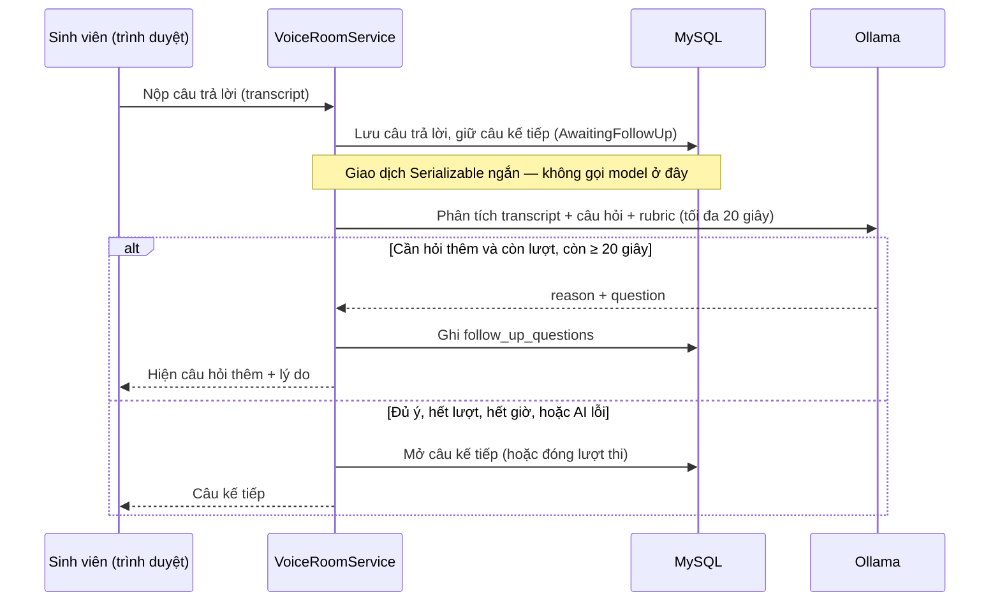
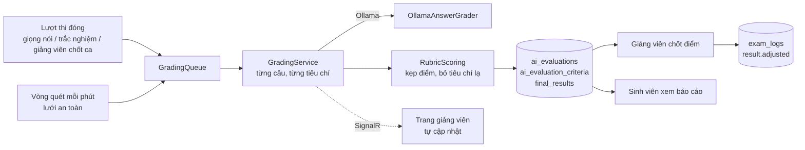

# Phần 6 — AI hỏi xoáy, chấm điểm và kết quả

Bản tổng kết phần việc số 6 trong bảng phân công ASM2 của đề tài AIVES.

| | |
|---|---|
| Người thực hiện | Wotiso2pm |
| Nhánh | `TriDev` (cắt từ `GiaThuan` — phần 5, phòng thi giọng nói) |
| Pull request | [zanh154/AS2#3](https://github.com/zanh154/AS2/pull/3) |
| Thời gian | 15–16/10/2026 |
| Trạng thái | **Hoàn thành 7/7 đầu việc**, đã chạy thật trên trình duyệt với Ollama |

Nhật ký làm việc chi tiết (kế hoạch, roadmap, từng lần đo, từng lỗi) nằm ở
[ai-hoi-xoay-cham-diem-ket-qua.md](ai-hoi-xoay-cham-diem-ket-qua.md). Tài liệu này chỉ tổng kết.

---

## 1. Phạm vi và kết quả

Phần 6 phủ **nhóm chức năng 3** (lõi phỏng vấn AI — phần hỏi xoáy) và **nhóm chức năng 4**
(hỗ trợ chấm điểm bằng AI) của đề tài, cùng một phần nhóm 5 (lưu vết) và nhóm 6 (báo cáo
cho sinh viên).

| # | Đầu việc | Kết quả |
|---|---|---|
| 1 | Phân tích transcript, phát hiện thiếu ý / mơ hồ / mâu thuẫn, sinh câu hỏi tiếp | ✅ AI quyết định có hỏi xoáy không, kèm lý do; câu hỏi nói trực tiếp với sinh viên |
| 2 | Tuân thủ giới hạn lượt và thời gian | ✅ Giới hạn mỗi câu, mỗi lượt; câu hỏi thêm không cộng giờ; còn dưới 20 giây thì không hỏi |
| 3 | Đánh giá theo rubric | ✅ Chấm từng tiêu chí, có điểm mạnh / điểm yếu / ý còn thiếu |
| 4 | Lưu điểm từng tiêu chí và nhận xét | ✅ Bảng mới `ai_evaluation_criteria`; AI lỗi thì để trống, **không bao giờ lưu thành 0** |
| 5 | Chuyển trang kết quả sang Razor Pages | ✅ `Pages/ExamResults/*`, URL giữ nguyên; thêm `Pages/MyResults` cho sinh viên |
| 6 | Giảng viên xem và điều chỉnh điểm, có lưu vết | ✅ Điểm giảng viên luôn thắng điểm AI; mỗi lần đổi ghi vào `exam_logs` |
| 7 | Thông báo tiến độ / kết quả qua SignalR | ✅ Trang giảng viên hiện "AI đang chấm x/y câu" rồi tự cập nhật khi xong |

---

## 2. Luồng hoạt động

### 2.1 Hỏi xoáy trong phòng thi giọng nói



Model **không bao giờ được gọi trong giao dịch giữ khoá** lượt thi. Nếu AI hỏng, chậm hoặc trả
về câu không dùng được, phòng thi vẫn chạy tiếp như không có AI. Nếu chính lời gọi cũng bị
mất, chỗ giữ câu kế tiếp tự hết hạn sau 25 giây.

### 2.2 Chấm điểm và chốt điểm



- Điểm một câu = tổng điểm các tiêu chí quy về thang 10. Phần hỏi xoáy của một câu được
  chấm **chung với câu gốc** (model đọc cả câu trả lời lẫn các lượt hỏi thêm).
- Điểm lượt thi = trung bình các câu; câu đào sâu kiểu ASM1 (một câu riêng) tính hệ số 0,5.
  Câu AI không chấm được thì bỏ khỏi phép tính, không tính là 0.
- **Điểm cuối = điểm giảng viên nếu có, không thì điểm AI.** Chấm lại không bao giờ ghi đè
  điểm giảng viên đã chốt. Giảng viên xoá điểm của mình thì điểm cuối quay về điểm AI.

---

## 3. Thành phần theo lớp

| Lớp | File | Vai trò |
|---|---|---|
| DataAccess | `Entities/FollowUpQuestion.cs`, `AiEvaluation.cs`, `FinalResult.cs` | Ánh xạ 3 bảng có sẵn trong dump nhưng chưa ai dùng, và 1 bảng mới |
| | `Repositories/GradingRepository.cs` | Đọc bài để chấm, lưu đánh giá, chốt điểm kèm log, tìm lượt chưa chấm |
| | `Repositories/VoiceRoomRepository.cs` | Thêm câu hỏi thêm và rubric vào dữ liệu phòng thi |
| Business — luật | `Policies/FollowUpTurnRules.cs` | Còn được hỏi thêm không, hạn trả lời câu hỏi thêm |
| | `Policies/RubricScoring.cs` | Biến điểm thô của model thành điểm an toàn để lưu |
| | `Policies/ResultAdjustmentRules.cs` | Thang 0–10, điểm cuối, dòng nhật ký |
| Business — AI | `Services/OllamaJsonClient.cs` | Gọi Ollama với JSON schema; không bao giờ ném lỗi |
| | `Services/OllamaFollowUpAnalyzer.cs` | Prompt + đọc kết quả hỏi xoáy |
| | `Services/OllamaAnswerGrader.cs` | Prompt + đọc kết quả chấm; bỏ mã tiêu chí khỏi nhận xét |
| | `Services/OllamaWarmUpService.cs` | Nạp sẵn model lúc khởi động app |
| Business — nghiệp vụ | `Services/VoiceRoomService.cs` | Cắm hỏi xoáy vào phòng thi |
| | `Services/GradingService.cs`, `GradingQueue.cs` | Chấm một lượt; hàng đợi + chấm nền + vòng quét |
| | `Services/ResultReviewService.cs` | Xem / chốt điểm (giảng viên), báo cáo (sinh viên) |
| Presentation | `Pages/ExamResults/*`, `Pages/MyResults/*` | Trang kết quả bằng Razor Pages |
| | `Hubs/SignalRGradingNotifier.cs` | Gửi tiến độ chấm tới nhóm của phiên thi |
| | `wwwroot/js/voice-room.js` | Hiện câu hỏi thêm, trạng thái "giám khảo đang xem" |
| | `wwwroot/js/grading-live.js` | Trang giảng viên tự cập nhật khi chấm xong |

---

## 4. Database

| Bảng | Mới / có sẵn | Dùng để |
|---|---|---|
| `follow_up_questions` | có sẵn trong dump, trước đây chưa dùng | Câu hỏi thêm, lý do, câu trả lời của sinh viên |
| `ai_evaluations` | có sẵn, trước đây chưa dùng | Điểm AI một câu, độ tin cậy, điểm mạnh / yếu / ý thiếu |
| `ai_evaluation_criteria` | **mới** | Điểm và nhận xét từng tiêu chí |
| `final_results` | có sẵn, trước đây chưa dùng | Điểm AI, điểm giảng viên, điểm cuối, người chốt |
| `exam_logs` | có sẵn | Thêm hành động `result.adjusted` |

Script: [`database/20261016_ai_evaluation_criteria.sql`](../database/20261016_ai_evaluation_criteria.sql)
— chỉ thêm bảng, chạy lại không sao. **Đã chạy trên Aiven ngày 15/10/2026.**
Dữ liệu thử: [`database/seed_test_rubrics.sql`](../database/seed_test_rubrics.sql), chạy sau
`seed_test_flow.sql` (AI chỉ chấm câu có rubric).

---

## 5. Cấu hình

| Khoá | Mặc định | Ghi chú |
|---|---|---|
| `Ollama:VivaModel` | `qwen2.5:7b-instruct` | Model cho hỏi xoáy và chấm. Để trống thì dùng `GenerationModel`. Cần `ollama pull qwen2.5:7b-instruct` |
| `Ollama:GenerationModel` | `qwen2.5:3b` | Vẫn dùng cho sinh câu hỏi từ tài liệu (RAG) |

Các ngưỡng nằm trong code, mỗi ngưỡng có ghi chú lý do: phân tích hỏi xoáy tối đa 20 giây,
chấm một câu tối đa 2 phút, giữ câu kế tiếp tối đa 25 giây, cần còn ít nhất 20 giây mới hỏi
thêm, quét lượt chưa chấm mỗi phút.

---

## 6. Cách chạy thử

1. Bật MySQL và Ollama (xem [local-runtime.md](local-runtime.md)), tải model:
   `ollama pull qwen2.5:7b-instruct`.
2. Tạo dữ liệu thử: chạy `database/seed_test_flow.sql` rồi `database/seed_test_rubrics.sql`.
   Ca thi tính theo giờ lúc chạy seed: SV1 thi được ngay, SV2 sau 15 phút, SV3 sau 30 phút.
   Mọi tài khoản thử dùng mật khẩu ghi ở đầu file seed.
3. Chạy `AssignmentPRN.Presentation` (F5 trong Visual Studio).

| Bước | Làm | Mong đợi |
|---|---|---|
| Hỏi xoáy | Đăng nhập `tflow.sv1@test.local` → Lịch thi của tôi → **"Thi giọng nói"** (không phải "Vào thi" — đó là bài trắc nghiệm, và một lượt đã bắt đầu ở chế độ nào thì khoá chế độ kia). Gõ "Em không biết ạ." vào ô *Văn bản nhận dạng* rồi nộp | "Giám khảo đang xem…", rồi câu hỏi thêm bắt đầu bằng "Em…" kèm lý do |
| Giới hạn | Tiếp tục trả lời yếu | Tối đa 2 câu hỏi thêm mỗi lượt (ca `[TFLOW-1]`) |
| Chấm | Đăng nhập `tflow.gv1@test.local`, mở bài của SV1 trước khi SV1 nộp câu cuối | Trang hiện "AI đang chấm x/y câu" rồi tự tải lại, có điểm từng tiêu chí |
| Chốt điểm | Nhập điểm + nhận xét → Lưu điểm chốt | Điểm cuối đổi, có dòng "Điểm chốt: a → b" |
| Sinh viên xem | SV1 → Xem điểm và nhận xét | Trước khi chốt: "Điểm tạm"; sau khi chốt: điểm và nhận xét của giảng viên |
| Phân quyền | `tflow.gv2` mở bài của SV1; SV2 mở báo cáo của SV1 | Bị chặn / "Không tìm thấy lượt thi" |
| AI tắt | Tắt Ollama, cho sinh viên khác thi | Bài thi vẫn chạy, không có câu hỏi thêm, bài để trống cho giảng viên — không phải 0 |

---

## 7. Kiểm thử tự động

| Nhóm | File | Số ca |
|---|---|---|
| Hỏi xoáy | `FollowUpAnalyzerTests`, `FollowUpTurnRulesTests`, `VoiceFollowUpTests` | 56 |
| Chấm điểm | `RubricScoringTests`, `AnswerGraderTests`, `GradingServiceTests` | 57 |
| Hàng đợi, vòng quét | `GradingQueueTests`, `GradingSweepTests`, thêm 2 ca ở `ExamDraftTests` | 6 |
| Kết quả, chốt điểm | `ResultReviewTests`, thêm kiểm HTTP ở `RazorModuleTwoHttpTests` | 25 |
| Trình duyệt | `voice-follow-up.test.cjs`, `grading-live.test.cjs` | 16 |

Cả dự án sau khi merge `main`: **381/381** test C#, **29/29** test trình duyệt. Mỗi lỗi sửa
sau khi chạy thật đều có test hồi quy, và test đó đã được xác nhận **thất bại trên code cũ**.

```bash
dotnet test AssignmentPRN.slnx
node --test "tests/browser/*.test.cjs"
```

---

## 8. Kết quả chạy thật

Máy i7-13620H, 32 GB, RTX 4060 Laptop; MySQL 8.4.9 cục bộ; Ollama; Chromium.

| Chỉ số | Đo được |
|---|---|
| Từ lúc nộp tới câu kế tiếp, model đã nạp | 0,5 – 3 giây |
| Lần gọi đầu sau khi bật máy | 33,4 giây → đã xử lý bằng cách nạp sẵn model lúc khởi động |
| Chấm một câu | 3,7 – 4,0 giây; một lượt 3 câu ≈ 11,5 giây |
| Từ lúc nộp câu cuối tới khi giảng viên thấy điểm | **18 – 42 giây**, không cần khởi động lại app |
| Câu hỏi thêm nói trực tiếp với sinh viên (prompt mới, model 3b) | 4/4 |

---

## 9. Lỗi đã tìm và sửa

Trong lúc làm và lúc chạy thật đã tìm và sửa các lỗi sau. Mỗi lỗi có một commit riêng.

- **Lượt thi giọng nói không bao giờ được đưa vào hàng đợi chấm**: lượt thi kết thúc ở giao
  dịch thứ hai, nhưng code chỉ xét giao dịch đầu. Bài trắc nghiệm thì chưa từng được đưa vào
  hàng đợi.
- Vòng quét đưa lại mãi những lượt không chấm được, mỗi phút một lần.
- Lượt thi bị giảng viên chốt ca hết giờ không được chấm.
- Model `qwen2.5:3b` với prompt cũ: 0/10 câu hỏi thêm dùng được. Đã tách model riêng cho vấn
  đáp, viết lại prompt, và loại câu không phải câu hỏi.
- Mã tiêu chí trong database lọt vào nhận xét sinh viên đọc ("mất điểm ở tiêu chí 87 và 99").
- Trang sinh viên ghi "giảng viên đã chốt" khi giảng viên chưa chốt.
- Hai trang kết quả mất tiêu đề và breadcrumb sau khi chuyển sang Razor Pages; `_Breadcrumb`
  báo lỗi 500 với mọi liên kết tới trang Razor Pages.
- Màn hình giảng viên không nhận thông báo SignalR.
- Định dạng điểm trong nhật ký phụ thuộc ngôn ngữ máy ("7,5" và "7.5") — giờ cố định.

---

## 10. Giới hạn và việc còn lại

| Vấn đề | Ảnh hưởng | Đề xuất |
|---|---|---|
| Chưa đo lại chất lượng hỏi xoáy với bản 7b | Điểm demo nhóm 3 phụ thuộc vào đây | Tải 7b, chạy lại 10 câu ở nhật ký mục 9b |
| Model nhỏ: câu hỏi thêm đôi khi **lộ đáp án**; chấm có thể bỏ qua phần sinh viên tự sửa | Giảng viên phải đọc lại trước khi chốt | Đúng lý do có bước chốt tay; có thể thêm luật chặn câu hỏi chứa đáp án |
| Mất kết nối SignalR thì trang kết quả không tự bắt kịp | Phải F5 | Thêm kiểm tra định kỳ khi kết nối lại |
| Sinh viên trong phiên cũng nhận sự kiện "đang chấm" của bạn cùng phiên (không có điểm) | Lộ thời điểm chấm | Gửi riêng cho giảng viên và admin |
| Ô "ĐIỂM" trắc nghiệm ASM1 (luôn 0 với bài giọng nói) cạnh "AI ĐỀ XUẤT" | Dễ nhầm | Nhóm quyết định ẩn hay đổi tên |
| Thống kê lớp và xuất bảng điểm (nhóm chức năng 6) | Chưa nhánh nào có | Ngoài phần 6; cần người nhận |
| STT/TTS cố định tiếng Việt, chưa đo độ chính xác STT | Nhóm 7 và yêu cầu phi chức năng | Thuộc phần 5 |

---

## 11. Lịch sử

34 commit trên `TriDev` (yêu cầu tối thiểu 12), từ kế hoạch tới bản đã chạy thật:

1. **Kế hoạch** — `903efdd` tài liệu kế hoạch; `cdb984c` gỡ `bin-alt/` khỏi Git.
2. **Hỏi xoáy** — `5110032` ánh xạ bảng; `a2d9f27` AI quyết định hỏi thêm; `d0ad330` giới
   hạn lượt; `eeb8858`, `a36c441` cắm vào phòng thi.
3. **Chấm điểm** — `c70bae4` làm sạch điểm model; `789a222` chấm theo rubric; `1be7d15`
   chấm nền; `9ccda79` SignalR phía server.
4. **Kết quả** — `cbb16d8` Razor Pages; `055a86a` giảng viên chốt điểm; `08cf9ab` báo cáo
   sinh viên.
5. **Database chung** — `12db2ad`, `043cfc3` công cụ chạy migration; `cfd0502` đã chạy trên Aiven.
6. **Đo thật và sửa** — `3ea2bb7` đo với Ollama; `456c017` → `c70ea4a` các bản sửa ở mục 9;
   `44feed9` merge `main`; tài liệu tổng kết này.
